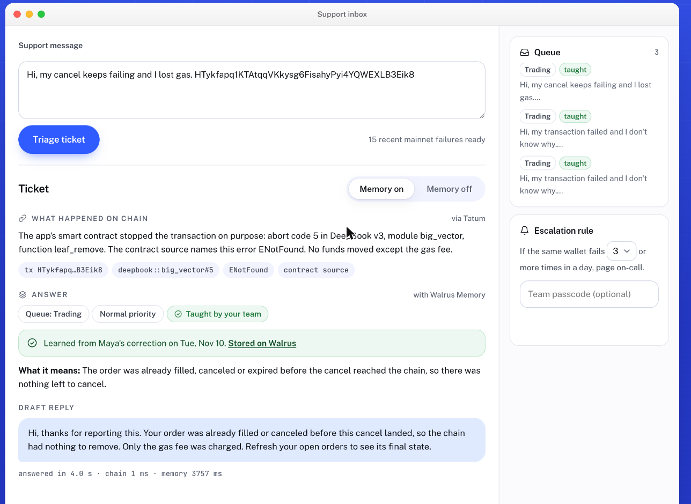

# Ticketwise

Ticketwise is a support agent for Sui apps. It reads a user's failed transaction through Tatum, explains the abort code in plain words, and learns what each error means from your team's corrections.

Those corrections live in Walrus Memory on Sui mainnet, not in a database on our server. Anyone can check each one on Walruscan, and if the server or its search index is wiped, they come back from Walrus.

**Live app: https://ticketwise-gamma.vercel.app**



**Try it in 30 seconds**

1. Open the live app. It answers a real failed mainnet transaction as soon as the page loads.
2. Click **Use a real failed transaction** until you get one marked "Nobody has taught me what this error means".
3. Fill in **Teach Ticketwise** and save. Without the team passcode it goes to your own sandbox namespace.
4. Click **Triage this ticket again**. The answer now says "Learned from your correction", with a link to the Walrus blob. Flip **Memory off** to see the answer without it.

---

## What it does

Most support tickets for a Sui app come from a handful of contract errors. A trader's cancel fails because the order already filled. A swap aborts because the price moved past the slippage limit. The user sees "transaction failed" and writes in. Someone on the team looks it up, again.

Ticketwise handles that loop:

- **Reads the chain.** Paste the user's message. If it contains a transaction digest or a wallet address, Ticketwise fetches the transaction from Sui mainnet through Tatum's Sui gateway and gets the status, abort code, module and function.
- **Names the error.** It maps the abort code to the constant in the contract's own source (DeepBook v3, Bluefin Spot and Cetus CLMM are mapped, 276 codes, each linked to a pinned source line).
- **Answers from what the team taught it.** If a teammate has corrected this error before, the answer comes from that correction: meaning, reply, queue and priority, with the teammate's name and date. If nobody has, it says so.
- **Learns from one correction.** Correct an answer once and it is saved to Walrus Memory. Every later ticket with the same error gets that answer.
- **Follows escalation rules.** "If the same wallet fails 3 or more times in a day, page on-call" is stored as a memory too, and checked against the wallet's real failures from the chain.

## Why it needs Walrus Memory and Tatum

- **Tatum** is how every answer starts. The diagnosis comes from mainnet data read through `sui-mainnet.gateway.tatum.io`, not from the user's description. The live "Use a real failed transaction" button samples recent failures from DeepBook, Cetus, Bluefin and Aftermath through Tatum.
- **Walrus Memory** is where the team's knowledge lives. Corrections and rules are written with `remember`, found with `recall`, listed on the Proof page with links to each blob on Walruscan, and can be rebuilt with `restore` after the relayer's index is deleted.

## Same memory from any MCP client

Ticketwise is also a read-only MCP server at `https://ticketwise-gamma.vercel.app/api/mcp` (streamable HTTP). A coding assistant or another agent can read what support taught, from the same Walrus Memory namespace the inbox uses:

```bash
claude mcp add --transport http ticketwise https://ticketwise-gamma.vercel.app/api/mcp
```

| Tool | What it returns |
|---|---|
| `triage_ticket` | Reads the failed transaction through Tatum and answers from the team's corrections |
| `lookup_error` | What the team taught about one error key, such as `deepbook::big_vector#5`, with the Walrus blob |
| `list_team_memory` | How many memories the team has on Walrus, and the escalation rule in force |

Writes stay in the inbox, behind the team passcode, because they spend the shared Walrus quota.

## Proof it works

- **Replay scorecard** (`/scorecard`): 661 real failed transactions from DeepBook v3, Cetus CLMM and Bluefin Spot over 13 days (Oct 29 to Nov 10), read through Tatum. Corrections were taught from the first 435, split by time. Of the last 226, 0 were answered with team knowledge with memory off, and 226 with memory on. Every error in the later part had already appeared in the earlier part. An error that only appears later would stay unanswered until someone teaches it.
- **Durability check** (`/proof`): save a correction, delete the relayer's search index for that namespace, show recall coming back empty, restore from Walrus, recall again. The last run on the live deployment restored 1 of 1 memories in 4.5 s.
- **Team memory** (`/proof`): every memory in the team namespace, with its Walruscan link.

## Abuse controls

The demo is public, and Walrus writes have a shared quota, so:

- Visitors write only to their own sandbox namespace. Writing to the team namespace needs the team passcode.
- Saves are limited per visitor, per IP and globally each hour. Triage is limited per IP.
- The durability check is teammates only.

## Run it yourself

```bash
npm install
cp .env.example .env.local   # add TATUM_API_KEY, MEMWAL_KEY, MEMWAL_ACCOUNT_ID, TEAM_PASSCODE
npm run dev
```

Without Walrus keys the app runs with an in-process store and says so on every ticket. Tests: `npm test`.

Rebuild the replay data and scorecard:

```bash
npx tsx scripts/build-replay.mts     # collects real failures through Tatum
npx tsx scripts/run-scorecard.mts    # teaches from the earlier part, scores the later part
```

## How it's built

- Next.js 15 (App Router) on Vercel, Node runtime for every API route.
- `src/lib/tatum.ts`: Sui GraphQL through Tatum's gateway (transaction by digest, failures by sender, transactions calling a package in a checkpoint window).
- `src/lib/diagnose.ts`: turns a failed transaction into a stable failure key (`package::module#code`) and a plain-language summary.
- `src/lib/memory.ts`: Walrus Memory through `@mysten-incubation/memwal`. Corrections and rules are stored as one-line records and recalled by exact failure key.
- `src/lib/triage.ts`: chain read, memory recall and rule check for one ticket.
- `src/data/error-maps.json`: abort codes from pinned contract source.

## Limits

- Only DeepBook v3, Bluefin Spot and Cetus CLMM have source-mapped error names. Other packages still get a diagnosis and can still be taught, but without a source name.
- A Walrus write takes about 20 seconds before it can be recalled.
- A ticket without a digest or address falls back to matching past cases by meaning, which is less reliable than the exact error key.
